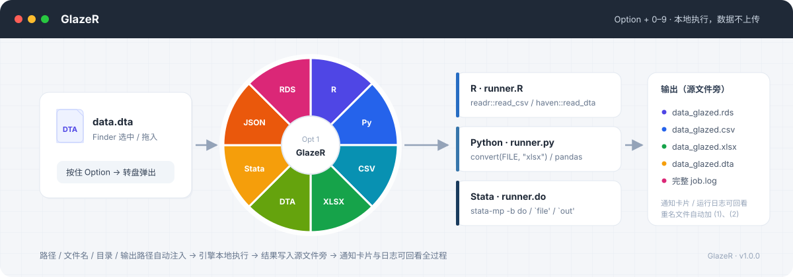

<div align="center">
  
  <h1>GlazeR</h1>
  <p><strong>一格一函数：把任意 R / Python / Stata 代码挂到 macOS 文件转盘上</strong></p>
  <p>选中文件 → 按住快捷键（可加 0–9 选转盘）→ 松手到扇区 → 立刻用你的函数处理它</p>
  <p><em>One slice, one function. R / Python / Stata run locally on your Mac — no upload, no third-party Swift dependencies.</em></p>
</div>

<p align="center">
  
  
  
  
  
  
  
  
</p>

<p align="center">
  <a href="MANUAL.en.md"><strong>English guide</strong></a> ·
  <a href="README.zh-CN.md"><strong>完整中文手册</strong></a> ·
  <a href="examples/wheels.glazer">示例 .glazer 配置</a> ·
  <a href="../../releases">Releases</a>
</p>

<p align="center">
  <picture>
    <source media="(prefers-color-scheme: dark)" srcset="assets/hero-dark.svg" />
    
  </picture>
</p>

> 转盘交互参考 [r-stata/DataWheel](https://github.com/r-stata/DataWheel) 与 [KnifeLemon/Filee](https://github.com/KnifeLemon/Filee/)。DataWheel 做的是「一格一格式」，GlazeR 把它扩展成「**一格一函数**」。

## 目录

- [为什么需要 GlazeR](#为什么需要-glazer)
- [核心能力](#核心能力)
- [安装](#安装)
- [3 步上手](#3-步上手)
- [三种引擎与路径变量](#三种引擎与路径变量)
- [.glazer 配置文件](#glazer-配置文件)
- [长任务、日志与权限](#长任务日志与权限)
- [项目结构](#项目结构)
- [开发与验证](#开发与验证)
- [常见问题](#常见问题)
- [贡献、致谢与许可](#贡献致谢与许可)

## 为什么需要 GlazeR

日常数据工作里，格式转换只是第一步：读入 → 清洗 → 概览 → 出图 → 导出 → 跑一段 do 文件 → 生成报告。这些操作往往每次都要打开 IDE、改一次文件路径、再跑一遍脚本。

GlazeR 把「文件路径」变成手势的输入：在 Finder 里选中文件，按住快捷键呼出转盘，松手到某个扇区，这个扇区绑定的 **R 函数 / Python 函数 / Stata 命令 / 自定义代码** 就会带着路径和你预设的默认参数执行，结果自动写到源文件旁边。所有计算都由本机 `Rscript` / `python3` / `stata-mp -b do` 子进程完成，数据不离开电脑；App 本身是原生 SwiftUI，纯 `swiftc` 编译，不需要 SwiftPM 或任何第三方依赖。

典型用途：批量读 CSV/DTA/XLSX 并转 RDS、一键 `describe` / `summarize`、批量出图或渲染 HTML 报告、DataWheel 式十种表格格式互转、把常用的清洗脚本固化成一个扇区。

## 核心能力

| 维度 | 能力 |
|---|---|
| 五种呼出方式 | 窗口拖放 · 组合键 + 拖动（任意 App）· Finder 选中后按住组合键 · 组合键 + `0–9` 直接选转盘 · 右键服务 / Dock 拖放 |
| 多转盘 | 最多 **10 套**（数字槽位 `0–9`），每套 2–12 个扇区；可复制、改名、独立设置组合键，支持 5 种一键预设 |
| 三引擎混排 | 每个扇区独立选择 **R / Python / Stata**；共用同一套超时、取消、阶段提示与结果收集机制 |
| 扇区配置 | 函数或自定义代码、外部 `.R` / `.py` / `.do` 脚本、接收路径的参数名、默认参数表达式、逐文件 / 整批处理、输出模式、文件名后缀、12 色配色 |
| 格式转换 | Python 内置 DataWheel 读写逻辑：`csv` / `tsv` / `txt` / `xlsx` / `dta` / `rds` / `parquet` / `feather` / `json` / `jsonl` |
| 配置即文本 | `.glazer` 是注册过的文档类型（UTI `com.rstata.glazer.wheel`，含专属图标）：双击用带语法高亮的编辑窗口打开，可保存 / 另存为 / 应用到转盘；支持三种导入模式并自动备份 |
| 可观测 | 通知卡片显示实时阶段与耗时、最近运行、完整 `job.log`；Stata 失败时额外保存 `job.do` / `job.log` / `result.txt` 诊断快照 |
| 稳健性 | 默认跳过用户 `~/.Rprofile`、虚拟环境可读性检查、R / Python / Stata 独立环境自检、权限自检中心 |

## 安装

**环境要求**：macOS 13+、Swift 5 工具链；按实际使用的引擎**按需**安装 R 4.x / Python 3.9+ / Stata 14+（不需要三样都装）。Python 格式转换需要 `pandas pyarrow pyreadstat pyreadr openpyxl xlsxwriter xlrd`。

```bash
# 在项目根目录执行
zsh native/build_native.sh         # → build/GlazeR.app
open build/GlazeR.app

zsh native/build_dmg.sh            # → build/dist/GlazeR-arm64.dmg、GlazeR-x86_64.dmg
swift build/make_icons.swift       # 可选：重新生成 App / 菜单栏 / .glazer 文档图标
```

构建脚本会用稳定的自签名身份 `GlazeR Dev` 签名（找不到则回退 ad-hoc）。**ad-hoc 签名会在每次重编译后丢失辅助功能授权**：建议在「钥匙串访问」里创建一张名为 `GlazeR Dev` 的自签名代码签名证书，或直接把 App 装到 `/Applications`。

DMG 属于本地构建产物（已被 `.gitignore` 排除），仓库发布后可从 [Releases](../../releases) 下载。安装后建议把 `GlazeR.app` 拖进 `/Applications`——这样 `.glazer` 文件会自动关联到 GlazeR，也能避开 macOS 对「文稿」目录的 TCC 授权问题。

**首次启动**：打开「设置 → 权限检查」授权 **辅助功能**（必需，用于全局事件监听）与 **输入监控**（强烈建议，让后台也能收到拖拽事件），再分别检查你要用的 R / Python / Stata 环境。

## 3 步上手

1. **建转盘**：转盘编辑器 →「新建…」→ 选一个预设：`R 函数处理（示例）`、`Python 函数处理（示例）`、`Stata 命令处理（示例）`（6 扇区）或 `DataWheel 格式转换（10 种格式）`；给这套转盘分配数字槽位（如 `1`）。
2. **配扇区**：以 `readxl::read_excel` 为例，引擎 `R`、执行方式 `函数`、路径参数 `path`、默认参数 `sheet = 1` / `col_names = TRUE`、输出 `.rds`、后缀 `_data`。文件路径会自动注入，不需要手写。
3. **用起来**：在 Finder 选中文件 → 按住 `⌥`（默认组合键，可在设置里改成 ⌘ ⌃ ⌥ ⇧ ⇪ 任意组合）→ 转盘在光标处弹出 → 松手 / 点击目标扇区。`⌥1` 可以直接呼出槽位 1 的转盘，并自动带上 Finder 选中的文件。

结果文件名是 `原文件名 + 后缀 + 扩展名`，重名时自动追加 `(1)`、`(2)`，绝不覆盖原文件；CSV 输出带 UTF-8 BOM，中文在 Excel 中不会乱码。

## 三种引擎与路径变量

自定义代码、默认参数表达式、外部脚本里都能直接使用下表变量，编辑器会按当前引擎给出提示。

| 含义 | R | Python | Stata |
|---|---|---|---|
| 完整路径 | `.file` | `FILE` / `glazer.file` | `` `file'`` / `$file` |
| 文件名.扩展名 | `.filename` | `FILENAME` | `` `filename'`` |
| 所在目录 | `.dir` | `DIR` | `` `dir'`` |
| 不含扩展名的名字 | `.filebasename` | `FILEBASENAME` | `` `filebasename'`` |
| 全部输入路径 | `.files` | `FILES` | `` `file1'…`fileN'``、`nfiles` |
| 建议的输出**文件**路径 | `.out` | `OUT` | `` `out'`` / `$out` |
| 输出**目录** | — | `convert(…, outdir=DIR)` | `` `outdir'`` / `$outdir` |
| 自定义写出的返回值 | `.result` | `result` | — |

```r
d <- read.csv(.file, check.names = FALSE)
cat("rows:", nrow(d), "\n")
summary(d)
```

```python
import pandas as pd
result = pd.read_csv(FILE).describe().to_string()
```

```stata
use `"`file'"', clear
describe
summarize
```

> **Stata 注意**：`` `out'`` 是**带扩展名的完整输出文件路径**，不是目录。写成 `` `out'/xxx.csv `` 会触发 `invalid file specification` / `could not be opened`（`r(603)`）。请直接写 `` export delimited using `"`out'"', replace ``，或用 `` `outdir'/`filebasename'.csv `` 自己拼文件名；GlazeR 会在执行前检测并提示这类写法。

三引擎共用同一个执行层：R 由 `engine/runner.R`（仅基础 R）、Python 由 `engine/runner.py` + `engine/glazer_formats.py`、Stata 由 `engine/runner.do`（`stata-mp -b do`，通过 `result.txt` 回传结果）承载。详细规则见[完整中文手册](README.zh-CN.md)与 [English guide](MANUAL.en.md)。

## .glazer 配置文件

转盘配置可以导出成人类可读的 UTF-8 纯文本（格式 v3），改完再导入。文件开头带完整注释说明，字段是 `键 = 值`，多行代码用三引号块，参数可重复写 `参数.名称 = 表达式`：

```text
【转盘】
编号 = EXAMPLE-WHEEL-001
名称 = R 数据处理（示例）
快捷键 = option
槽位 = 1
扇区数 = 1

【扇区】
标签 = CSV→RDS
说明 = readr 读取 CSV
引擎 = R
执行方式 = 函数
函数 = readr::read_csv
路径参数 = file
参数.show_col_types = FALSE
输出 = .rds
输出后缀 = _data
颜色 = #4F46E5
```

- 也接受英文段落标记 `[[wheel]]` / `[[slice]]` 与中英文键别名；注释、空行、全角冒号、BOM 都会容错处理。
- 双击 `.glazer` 打开的是**可编辑文档窗口**：R / Python / Stata 关键字、字符串、注释、路径宏、三引号代码块都有语法高亮，可切换明暗主题、保存 / 另存为，再点「应用到转盘」。
- 导入支持「替换匹配 / 全部作为新增 / 清空后导入」，导入前自动备份到 `~/Library/Application Support/GlazeR/config.before-import.json`。
- 完整示例：[`examples/wheels.glazer`](examples/wheels.glazer)（5 套转盘、25 个扇区，覆盖 R / Python / Stata 与槽位 1–5）。

## 长任务、日志与权限

长时间渲染、转换、批量任务不会再看起来「卡住」：通知卡片实时显示 `R is running …` / `Writing output …` 等阶段与耗时，**超时默认 300 秒**（可在设置里调 30–1800 秒），进行中的任务可以点「取消」真正终止子进程。Stata 批处理模式没有 stdout，因此成功与失败都会把完整 `job.log` 附到结果上，可在通知卡片或「运行日志」里展开。

| 位置 | 内容 |
|---|---|
| `~/Library/Application Support/GlazeR/config.json` | 全部转盘、扇区、参数、槽位与全局设置 |
| `~/Library/Application Support/GlazeR/glazer.log` | 完整运行日志（失败的 Stata 任务会追加整份 `job.log`） |
| `~/Library/Application Support/GlazeR/logs/Stata-<时间>-<扇区>/` | 失败诊断快照：`job.do`、`job.log`、`result.txt` |

| 权限 | 是否必需 | 用途 |
|---|---|---|
| 辅助功能 | ✅ 必需 | 全局 `CGEventTap`，支持「组合键 + 拖动」「组合键 + 数字」 |
| 输入监控 | 强烈建议 | 在 HID 层挂载事件监听，App 隐藏 / 后台时仍能收到拖拽 |

## 项目结构

```text
GlazeR/
├── native/Sources/        SwiftUI / AppKit 源码：转盘、编辑器、文档窗口、三引擎调度
├── native/Tests/          独立 swiftc 回归套件（文本编解码、语法高亮、Stata 引擎/日志）
├── native/Info.plist      Bundle 信息、.glazer UTI 与文档图标声明
├── engine/                runner.R / runner.py / glazer_formats.py / runner.do
├── examples/wheels.glazer 完整配置示例（v3）
├── testdata/              示例作业与用户自定义 R 函数
├── build/                 图标资源与构建产物（App / DMG，默认不入库）
├── assets/                hero.svg / hero-dark.svg（GitHub 深浅主题头图）
├── README.zh-CN.md        完整中文手册
└── MANUAL.en.md           完整英文手册
```

## 开发与验证

```bash
zsh native/build_native.sh                 # 编译 + 打包 build/GlazeR.app
zsh native/build_dmg.sh                    # arm64 / x86_64 双架构 DMG + 产物校验
swiftc -typecheck -swift-version 5 -disable-sandbox -parse-as-library native/Sources/*.swift
plutil -lint native/Info.plist
```

独立回归套件（不依赖 Xcode，均用 `swiftc` 直接编译，详见[英文手册](MANUAL.en.md)中的完整命令）：

| 套件 | 覆盖内容 |
|---|---|
| `textcodec_roundtrip.swift` | `.glazer` 导出 → 解析往返一致性（78 项检查） |
| `syntax_highlight_test.swift` | 三引号代码块、Stata 宏、注释等（22 项检查） |
| `stata_engine_test.swift` | Stata 环境检测 + 真实 `.dta` 写出 |
| `stata_path_log_test.swift` | `` `out'`` / `` `outdir'`` 语义与失败日志回传（11 项检查） |
| `gen_example.swift` | 重新生成 `examples/wheels.glazer` |

引擎也可以脱离 App 单跑：`Rscript engine/runner.R --check "haven,readr,readxl"`、`python3 engine/runner.py --check`。

## 常见问题

- **HTML 任务一直转圈没输出**：脚本里调用了 `servr::httd()`——它在 RStudio 交互会话里是守护进程，在 `Rscript` 下会永久阻塞。改用 `pagedown::chrome_print()` 直接打印本地 HTML；引擎已自动补齐 headless Chrome 的 `--no-sandbox` 兼容参数。
- **R 报 `~/.Rprofile` 里的字体 / `source()` 错误，但 RStudio 正常**：GUI 子进程的「文稿」目录 TCC 授权与 RStudio 不共享。设置里默认开启「跳过用户 ~/.Rprofile」（`R_PROFILE_USER=/dev/null`，仍保留 `.Renviron` 与站点级 `Rprofile.site`）。
- **Stata 报 `r(603)` / `invalid file specification`**：把 `` `out'`` 当目录用了，参见[上文](#三种引擎与路径变量)；完整 `job.log` 在通知卡片和日志页都能展开。
- **转盘不出现 / 数字键无效**：先在「设置 → 权限检查」跑监听自检，确认槽位已分配且组合键没被其他 App 占用。
- 更多排查（TCC、虚拟环境、解释器路径、`.glazer` 默认打开方式等）见[完整中文手册](README.zh-CN.md)。

## 贡献、致谢与许可

欢迎通过 [Issue](../../issues/new) 反馈问题、通过 [Pull Request](../../pulls) 提交改进；提交前请至少跑一遍上表的回归套件，并尽量附上复现文件与 `glazer.log` 片段。若你写了好用的扇区预设，也欢迎把它整理进 `examples/wheels.glazer`。

转盘交互与全局监听改编自 [r-stata/DataWheel](https://github.com/r-stata/DataWheel)，其灵感来自 [KnifeLemon/Filee](https://github.com/KnifeLemon/Filee/)；项目由微信公众号 **RStata** 维护。所有计算均在本机完成，不上传任何数据。如果它帮你省下了重复劳动，欢迎给仓库点个 ⭐。

---

<p align="center"><a href="MANUAL.en.md">English guide</a> · <a href="README.zh-CN.md">完整中文手册</a> · <a href="../../releases">Releases</a></p>
